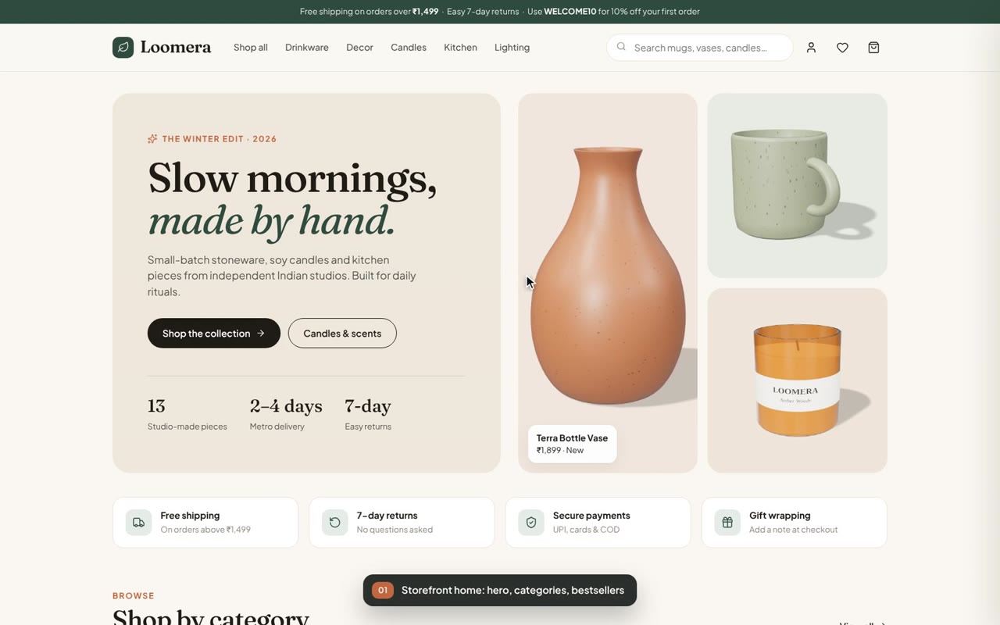

# Loomera: e-commerce platform (demo project)

A complete online store for a fictional home and kitchen brand. It covers the full shopping journey, from browsing to checkout, plus an admin dashboard for the store owner.

**▶ Live demo:** https://gunjan0716.github.io/loomera-ecommerce/
**🎬 Walkthrough video:** [`demo/loomera-demo.mp4`](demo/loomera-demo.mp4)



> Loomera is a demo brand. Products, prices and orders are sample data, and payments run in test mode (no real charge).

---

## Features

| Area | What it does |
|---|---|
| **Storefront** | Hero banner, trust badges, category tiles, bestsellers, promo banner, newsletter footer |
| **Search** | Live search with instant product suggestions as you type |
| **Catalogue** | Category, colour and price filters, sorting, active filter chips, result count |
| **Product page** | Colour variants that swap the gallery, thumbnails, quantity, pincode delivery-date check, stock alerts, care and shipping accordions, related products |
| **Wishlist** | Save items with one tap; the header counter updates instantly |
| **Bag** | Slide-out drawer, quantity editing, `WELCOME10` coupon, free-shipping progress meter |
| **Checkout** | Address form with step progress, Standard / Express delivery, UPI / card / cash-on-delivery (test mode), live order summary |
| **Order confirmation** | Order ID, delivery estimate and a tracking timeline (Placed → Packed → Shipped → Delivered) |
| **Admin dashboard** | Revenue, orders, AOV and conversion KPIs, a 7-day revenue chart, top products, recent orders (new orders appear in real time) and low-stock alerts |
| **Responsive** | Mobile-first layout with a bottom tab bar and full-screen bag on phones |

## Tech
- **HTML, CSS and vanilla JavaScript** single-page app with hash routing; no framework and no build step
- State kept in `localStorage`, so the bag, wishlist and orders survive a refresh
- Hand-written SVG revenue chart with a line-draw animation
- **Product photography rendered in 3D** with three.js (`render/`): lathe-modelled ceramics, glass and steel with studio lighting and soft shadows
- Walkthrough video recorded automatically with Playwright and the Chrome DevTools screencast, then encoded with FFmpeg (`rec/`)

## Project structure
```
app/
  index.html      entry point
  app.js          routing, pages, cart, checkout, admin
  data.js         product catalogue and sample orders
  styles.css      design system and responsive layout
  icons.js        Lucide icon paths
  showcase.html   phone mock-up used in the video
  img/  fonts/
render/           three.js product renderer (render.html + render.py)
rec/              scripted walkthrough recorder (rec.py)
demo/             walkthrough video
```

## Run locally
```bash
python3 -m http.server 8765
# open http://localhost:8765/app/
```
Try the coupon **WELCOME10** and any 6-digit pincode, such as `302001`.

---
Built by **Gunjan Khandelwal**. Open to freelance e-commerce and mobile app projects.
